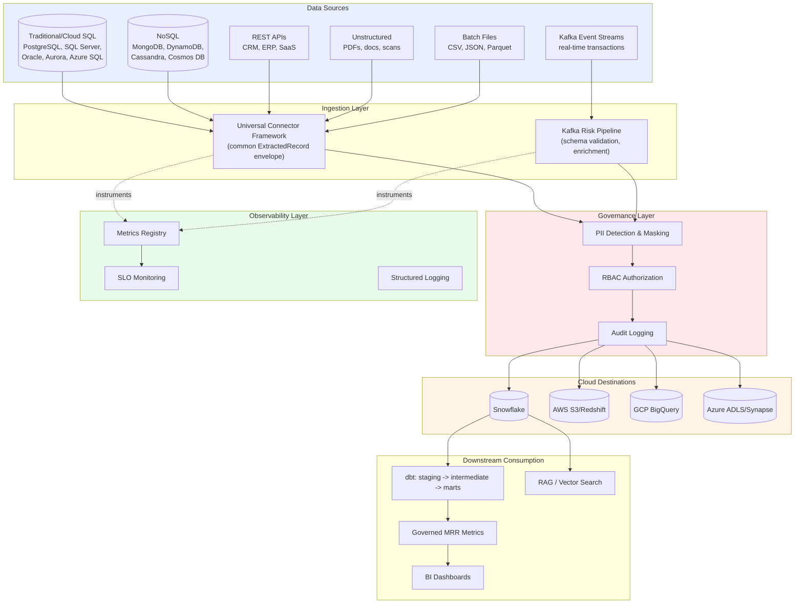
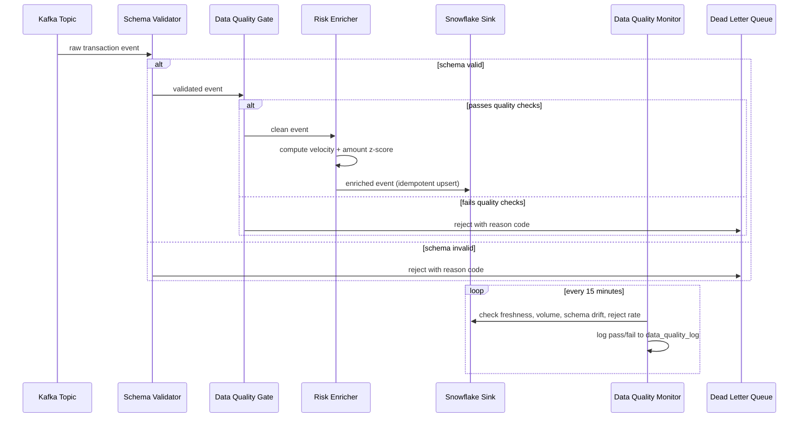
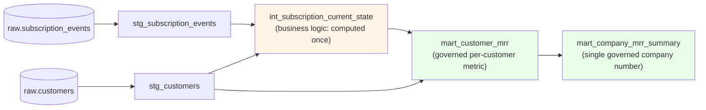
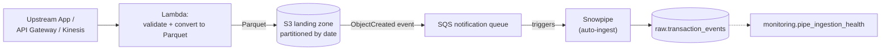
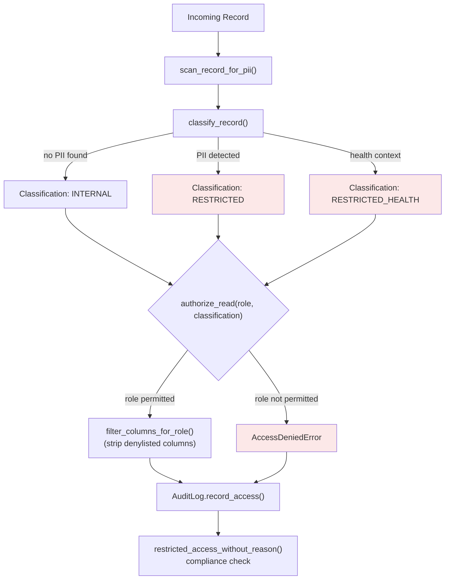
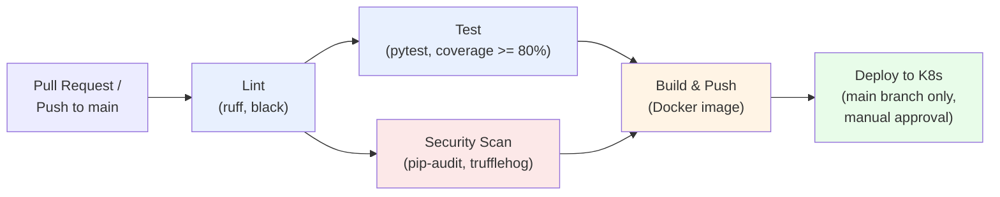

# Architecture Diagrams

These diagrams use [Mermaid](https://mermaid.js.org/) syntax, which GitHub
renders natively as real diagrams directly in this Markdown file, no
external image hosting or screenshots required.

## 1. Overall platform architecture (how every project in this repo fits together)

## 2. Real-time risk pipeline data flow

## 3. dbt staging -> intermediate -> marts lineage

## 4. AWS -> Snowflake ingestion path

## 5. Governance and access control flow

## 6. CI/CD pipeline stages

